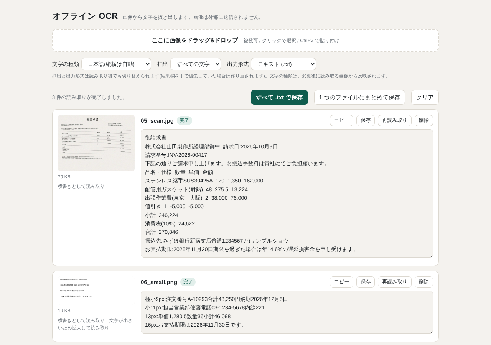

# オフライン OCR(画像 → テキスト / CSV)

画像から文字を抜き出す、ブラウザだけで動く OCR ツールです。
フォルダをコピーして `index.html` を開くだけで使え、**インストールもサーバーもインターネット接続も不要**です。
画像はこの PC のブラウザ内だけで処理され、外部には送信されません。

*An offline OCR tool that runs entirely in the browser (PP-OCRv5 on ONNX Runtime Web). Open `index.html` from disk — no install, no server, no network. The UI is in Japanese.*



## 特長

- **完全オフライン**: `file://` で直接開いて動きます。実行時の通信は 0 件です。
- **外部通信をブラウザが禁止**: `index.html` のコンテンツセキュリティポリシーで、外部への接続先を 1 つも許可していません。同梱のエンジンやモデルが何をしようとしても、`fetch`・`XMLHttpRequest`・`WebSocket`・画像の読み込みなどによる送信はブラウザが止めます。
- **AI-OCR**: PP-OCRv5(文字位置の検出 + 文字認識)を ONNX Runtime Web で実行します。
- **複数画像の一括処理**: ドラッグ&ドロップ、クリックで選択、Ctrl+V で貼り付け。
- **出力**: 画像ごとの `.txt` / `.csv`、または 1 つのファイルにまとめて保存。
- **数字のみの抽出**: 金額や番号だけを取り出せます。
- **自動調整**: 傾きの補正、縦書き・横書きの判定、小さい文字の拡大を自動で行います。

## 使い方

1. このリポジトリをダウンロードします(「Code」→「Download ZIP」、または `git clone`)。
2. 展開したフォルダの `index.html` をブラウザで開きます。「準備完了」と出たら使えます。
3. 画像をドラッグ&ドロップします。

別の PC やネットワークにつながっていない環境へは、フォルダごとコピーすれば移せます。
設定項目の詳しい説明は [`README.txt`](README.txt) にあります。

### 動作条件

- Chrome / Edge / Firefox の比較的新しい版
- 空きメモリ 1GB 以上が目安
- 対応形式: PNG / JPEG / BMP / GIF / WebP など、ブラウザが表示できる画像(PDF は非対応)

## 限界

- 単語間の空白は出ないことがあります(例: 「SUS304 25A」→「SUS30425A」)。
- 「※」など、モデルの文字一覧にない記号は出力されません。
- ぼけた小さい文字では 1 文字抜けることがあります。手書きは苦手です。
- 縦書きは横書きより精度が落ちます。
- 全角の英数字と記号は半角にそろえて出力します。

動作確認は合成したテスト画像によるものです。**大事な数値は元の画像と見比べて確認してください。**

## 仕組み

| ファイル | 役割 |
|---|---|
| `index.html` | 画面と、結果の整形(数字抽出・CSV・保存) |
| `src/ai-worker.js` | 読み取り処理の本体(Web Worker)。検出 → 傾き補正して切り出し → 認識 → 行と列の整理 |
| `assets/*.js` | エンジンとモデルを Base64 にして `.js` に包んだもの |
| `tools/build.py` | `assets/` を元ファイルから作り直すスクリプト |

`file://` で開いたページは `fetch` や Worker の外部ファイル読み込みが制限されるため、
エンジン・モデル・Worker のコードをすべて `<script>` で読める `.js` に包み、Blob から Worker を起動しています。

認識モデルは中国語にも対応しているため、「文字の種類」が日本語のときは候補を日本語(CP932)の文字に絞り、
簡体字への取り違え(「単」→「单」など)を防いでいます。

## assets の作り直し

`assets/` は生成物です。`src/ai-worker.js` を変更したときや、モデルを差し替えるときは作り直します。

1. 次の 4 ファイルを 1 つのフォルダ(例: `vendor/`)に置きます。

   | ファイル | 入手先 |
   |---|---|
   | `onnxruntime-web-1.22.0.tgz` | <https://registry.npmjs.org/onnxruntime-web/-/onnxruntime-web-1.22.0.tgz> |
   | `ch_PP-OCRv5_det_mobile.onnx` | <https://www.modelscope.cn/models/RapidAI/RapidOCR/resolve/v3.9.2/onnx/PP-OCRv5/det/ch_PP-OCRv5_det_mobile.onnx> |
   | `ch_PP-OCRv5_rec_mobile.onnx` | <https://www.modelscope.cn/models/RapidAI/RapidOCR/resolve/v3.9.2/onnx/PP-OCRv5/rec/ch_PP-OCRv5_rec_mobile.onnx> |
   | `ppocrv5_dict.txt` | <https://raw.githubusercontent.com/PaddlePaddle/PaddleOCR/main/ppocr/utils/dict/ppocrv5_dict.txt> |

2. 実行します(Python 3 のみ。追加パッケージは不要)。

   ```
   python3 tools/build.py vendor
   ```

モデルは SHA-256 で照合します。値は [`THIRD_PARTY_NOTICES.md`](THIRD_PARTY_NOTICES.md) にあります。

## ライセンス

このリポジトリ独自の部分(`index.html`、`src/`、`tools/`、ドキュメント)は [MIT License](LICENSE) です。

同梱している第三者のソフトウェアには、それぞれのライセンスが適用されます。
詳細は [`THIRD_PARTY_NOTICES.md`](THIRD_PARTY_NOTICES.md)、全文は [`licenses/`](licenses/) にあります。

| 同梱物 | 権利者・配布元 | ライセンス |
|---|---|---|
| PP-OCRv5 mobile 検出・認識モデル、文字一覧 | [PaddleOCR](https://github.com/PaddlePaddle/PaddleOCR)(ONNX 変換: [RapidOCR](https://github.com/RapidAI/RapidOCR)) | Apache License 2.0 |
| ONNX Runtime Web 1.22.0 | [Microsoft](https://github.com/microsoft/onnxruntime) | MIT License |
